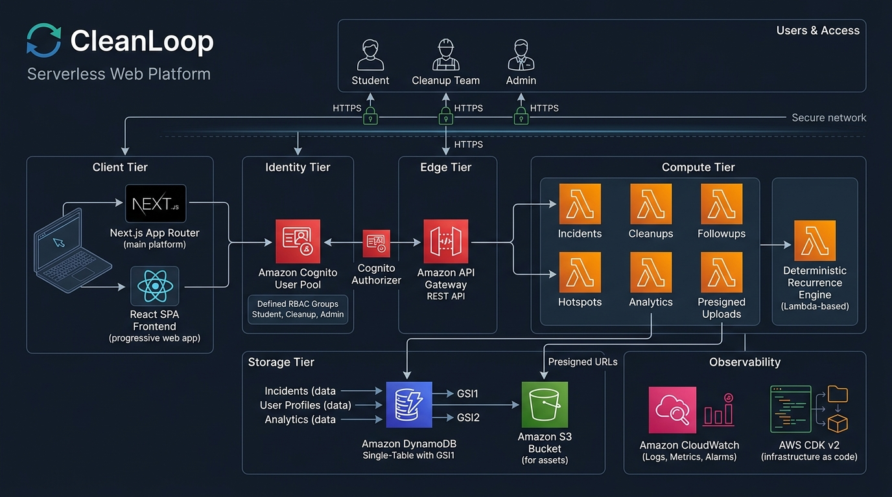

# CleanLoop MVP

> **The Trash That Came Back. Track. Clean. Prevent. Repeat.**

CleanLoop connects waste reports, cleanup activity, follow-up observations, and recurring hotspots to make environmental problems easier to understand.

---

## 1. MVP Core Workflow

```text
Student → Login → Report Waste → Incident Created
  ↓
Cleanup Team → Cleanup Recorded (CLEANED)
  ↓
Follow-up Observation → Waste Clean OR Waste Returns (WASTE_PRESENT)
  ↓
New Incident for Same Hotspot → Recurrence Calculated Deterministically
  ↓
Admin Dashboard → Recurring Hotspot Identified + Chronological Timeline
```

---

## 2. Enterprise System Architecture



### Interactive System Topology

```mermaid
flowchart TB
    %% Enterprise Architecture: CleanLoop Serverless Platform

    subgraph User_Actors ["Campus Users & Stakeholders"]
        direction LR
        Student["Student / Campus Reporter<br/><i>(Incident creation & history)</i>"]
        Crew["Cleanup Team<br/><i>(Triage backlog & cleanup action)</i>"]
        Admin["Facilities Admin / Auditor<br/><i>(Follow-ups & recurrence analytics)</i>"]
    end

    subgraph Client_Layer ["1. Client Tier (Next.js 16 • React 19 • Tailwind CSS)"]
        direction TB
        WebApp["Next.js Web Application<br/><b>App Router SPA</b>"]
        AuthContext["Cognito Auth Context<br/><i>JWT & Role State</i>"]
        ApiClient["Universal API Client<br/><i>Bearer Token & S3 Direct Upload</i>"]
        WebApp --- AuthContext
        WebApp --- ApiClient
    end

    subgraph Security_Layer ["2. Identity & Access Management (AWS Cognito)"]
        direction TB
        CognitoUP["Amazon Cognito User Pool<br/><code>cleanloop-user-pool</code>"]
        CognitoClient["Cognito App Client<br/><code>cleanloop-web-client (No Secret)</code>"]
        subgraph Cognito_Groups ["Role-Based Access Control (RBAC)"]
            GrpStudent["Group: STUDENT"]
            GrpCleanup["Group: CLEANUP_TEAM"]
            GrpAdmin["Group: ADMIN"]
        end
        CognitoUP --- CognitoClient
        CognitoUP --- Cognito_Groups
    end

    subgraph Edge_Layer ["3. Ingress & API Gateway Tier"]
        direction TB
        ApiGateway["Amazon API Gateway (REST API)<br/><code>prod</code> Stage • CORS Enforced"]
        CognitoAuthorizer["Cognito User Pools Authorizer<br/><i>JWT Signature & Scope Validation</i>"]
        ApiGateway --- CognitoAuthorizer
    end

    subgraph Compute_Layer ["4. Serverless Compute Tier (AWS Lambda • Node.js 20.x)"]
        direction TB
        UploadsFn["<b>uploadsHandler</b><br/><code>POST /uploads/presign</code><br/><i>MIME & Size Validation</i>"]
        IncidentsFn["<b>incidentsHandler</b><br/><code>GET, POST, PUT /incidents</code><br/><i>Incident Lifecycle Management</i>"]
        CleanupsFn["<b>cleanupsHandler</b><br/><code>GET, POST /cleanups</code><br/><i>Cleanup Verification & Status Sync</i>"]
        FollowupsFn["<b>followupsHandler</b><br/><code>GET, POST /followups</code><br/><i>Post-Cleanup Condition Auditing</i>"]
        HotspotsFn["<b>hotspotsHandler</b><br/><code>GET /hotspots/*</code><br/><i>History & Chronological Timelines</i>"]
        AnalyticsFn["<b>analyticsHandler</b><br/><code>GET /analytics/overview</code><br/><i>Recurrence & Trend Aggregates</i>"]
        
        RecurrenceEngine["<b>Deterministic Recurrence Engine</b><br/><i>Temporal Analysis & Threshold Rules</i>"]
        HotspotsFn -.-> RecurrenceEngine
        AnalyticsFn -.-> RecurrenceEngine
    end

    subgraph Data_Layer ["5. Storage & Persistence Tier"]
        direction TB
        subgraph DynamoDB_Cluster ["Amazon DynamoDB (Single-Table Design: CleanLoopTable)"]
            TablePrimary["<b>Primary Partition (PK / SK)</b><br/><code>HOTSPOT#&lt;id&gt;</code> • <code>INCIDENT#&lt;id&gt;</code>"]
            GSI1["<b>GSI1: Status & Chronology</b><br/>PK: status | SK: createdAt<br/><i>(Backlog triage & field dispatch)</i>"]
            GSI2["<b>GSI2: Reporter Lookup</b><br/>PK: reportedBy | SK: createdAt<br/><i>(Student audit history)</i>"]
            TablePrimary --- GSI1
            TablePrimary --- GSI2
        end

        subgraph S3_Evidence ["Amazon S3 Storage"]
            S3Bucket["<b>Private Media Evidence Bucket</b><br/><code>CleanLoopMediaBucket</code><br/>• SSE-S3 Encryption<br/>• Block Public Access<br/>• Enforce SSL/TLS"]
        end
    end

    subgraph Observability_Layer ["6. Observability & Infrastructure as Code"]
        CloudWatch["Amazon CloudWatch Logs<br/><i>Structured JSON Logs & Retention: 14d</i>"]
        CDK["AWS CDK v2 (IaC)<br/><i>Reproducible CloudFormation Deployment</i>"]
    end

    %% Interactions & User Flow
    User_Actors ==>|"HTTPS / Browser"| WebApp

    %% Authentication Flow
    AuthContext <-->|"1. SRP Auth / JWT Tokens"| CognitoClient
    ApiClient -.->|"2. JWT Bearer Token"| CognitoAuthorizer

    %% Direct S3 upload flow
    ApiClient -->|"Step A: Request Presigned URL"| ApiGateway
    ApiGateway --> UploadsFn
    UploadsFn -->|"Generate Signed PUT (15m expiry)"| S3Bucket
    ApiClient ==>|"Step B: Direct Binary Upload (PUT)"| S3Bucket

    %% API Ingress Flow
    ApiClient ==>|"REST Requests (JSON)"| ApiGateway
    ApiGateway --> IncidentsFn
    ApiGateway --> CleanupsFn
    ApiGateway --> FollowupsFn
    ApiGateway --> HotspotsFn
    ApiGateway --> AnalyticsFn

    %% Lambda to DynamoDB Data Access
    IncidentsFn -->|"PutItem / UpdateItem / Query"| DynamoDB_Cluster
    CleanupsFn -->|"PutItem & UpdateStatus"| DynamoDB_Cluster
    FollowupsFn -->|"PutItem (Audit Condition)"| DynamoDB_Cluster
    HotspotsFn -->|"Query PK=HOTSPOT#id"| DynamoDB_Cluster
    AnalyticsFn -->|"Query & Aggregate"| DynamoDB_Cluster

    %% S3 Read Validation
    IncidentsFn -.->|"Read photoKey"| S3Bucket
    CleanupsFn -.->|"Read photoKey"| S3Bucket

    %% Logging & Operations
    Compute_Layer -.->|"Stream Structured Logs"| CloudWatch
    ApiGateway -.->|"Execution & Access Logs"| CloudWatch
    CDK -.->|"Provisions"| Security_Layer
    CDK -.->|"Provisions"| Edge_Layer
    CDK -.->|"Provisions"| Compute_Layer
    CDK -.->|"Provisions"| Data_Layer
```



### Architectural Highlights & Design Patterns

| Layer | Technology | Architectural Role & Enterprise Safeguards |
|---|---|---|
| **Client Tier** | Next.js 16 (App Router), React 19, Tailwind CSS | Responsive SPA with client-side role guards, real-time optimistic state updates, and direct-to-S3 media upload capabilities. |
| **Identity & Access (IAM)** | Amazon Cognito User Pool & App Client | Role-Based Access Control (**RBAC**) across `STUDENT`, `CLEANUP_TEAM`, and `ADMIN` groups. Strict password policy, SRP auth flows, and automated JWT token rotation. |
| **API Ingress** | Amazon API Gateway (REST API) | Dedicated `prod` deployment stage, strict CORS headers, request payload validation, and integrated `CognitoUserPoolsAuthorizer` for protected endpoints. |
| **Serverless Compute** | AWS Lambda (Node.js 20.x, TypeScript) | Ephemeral, auto-scaling microservices with dedicated least-privilege IAM policies. Complete isolation across incident, cleanup, follow-up, and analytics operations. |
| **Recurrence Engine** | Pure TypeScript Deterministic Engine | Decoupled core business domain logic analyzing temporal event sequences across cleanups and follow-up observations without heuristic ambiguity. |
| **Single-Table Storage** | Amazon DynamoDB (`CleanLoopTable`) | On-Demand (pay-per-request) capacity, Point-In-Time Recovery (**PITR**), single-table partitioned queries, and 2 purpose-built Global Secondary Indexes (`GSI1` and `GSI2`) eliminating expensive table scans. |
| **Object Evidence Storage** | Amazon S3 (`CleanLoopMediaBucket`) | Private media storage with `BlockPublicAccess=ALL`, server-side encryption (`SSE-S3`), SSL/TLS transport enforcement, and short-lived presigned upload URLs (15-minute expiry). |
| **Observability & IaC** | Amazon CloudWatch & AWS CDK v2 | Centralized JSON structured application logging (14-day retention window), fully reproducible CloudFormation infrastructure definitions in TypeScript. |

---

## 3. 5 Predefined Hotspots

- `HOTSPOT-001`: Library Gate
- `HOTSPOT-002`: Main Entrance
- `HOTSPOT-003`: Cafeteria Area
- `HOTSPOT-004`: Science Block
- `HOTSPOT-005`: Parking Area

---

## 4. Technology Stack

- **Frontend**: Next.js 16 (App Router), TypeScript, Tailwind CSS, Lucide icons
- **AWS Serverless**:
  - Amazon Cognito (Groups: `STUDENT`, `CLEANUP_TEAM`, `ADMIN`)
  - Amazon API Gateway (REST API with Cognito Authorizer)
  - AWS Lambda (Node.js 20.x runtime)
  - Amazon DynamoDB (Single-Table Design with `GSI1` & `GSI2`)
  - Amazon S3 (Private evidence bucket with presigned URLs)
  - Amazon CloudWatch (Structured application logging)
- **Infrastructure as Code**: AWS CDK v2 (TypeScript)

---

## 5. Repository Structure

```text
Cleanloop/
├── docs/
│   ├── architecture.md       # AWS Serverless architecture specification
│   ├── database.md           # DynamoDB single-table design & access patterns
│   ├── deployment.md         # Phase 11 AWS deployment guide
│   └── future-roadmap.md     # Out-of-scope features & roadmap
├── frontend/                 # Next.js 16 + React 19 + Tailwind CSS + TypeScript
│   ├── src/
│   │   ├── app/              # App Router pages (/login, /register, /dashboard, /report, etc.)
│   │   ├── components/       # UI components (Navbar, Footer, ProtectedRoute)
│   │   ├── context/          # Cognito AuthContext
│   │   ├── lib/              # Universal API client & Cognito helper
│   │   └── types/            # Domain interfaces & predefined hotspots
│   └── .env.example          # Environment variables template
├── infra/                    # AWS CDK TypeScript infrastructure stack
│   ├── bin/infra.ts          # CDK entrypoint
│   └── lib/cleanloop-stack.ts# CloudFormation stack resources
└── backend/                  # AWS Lambda handlers & services
    ├── src/
    │   ├── handlers/         # Lambda endpoints (incidents, cleanups, followups, hotspots, analytics, uploads)
    │   ├── services/         # Deterministic recurrence engine & DynamoDB client
    │   ├── scripts/          # Synthetic data seed script (Section 22)
    │   └── utils/            # Structured logging & standard API response
    └── tests/                # 34 automated unit, contract & scenario tests (Section 18 & 23)
```

---

## 6. Development & Testing Commands

### Run Automated Tests (Section 23)
```bash
cd backend
npm test
```
All 34 unit, contract, and scenario tests pass with 0 failures.

### Build All Packages
```bash
# Backend
cd backend && npm run build

# Frontend
cd frontend && npm run build

# CDK Infrastructure
cd infra && npm run build && npx cdk synth
```

### Local Dev Server
```bash
cd frontend
npm run dev
```
Open [http://localhost:3000](http://localhost:3000).

# Blog link:
https://builder.aws.com/content/3KX2nWqutIGMAXLX4r6ijPrqkGP/the-trash-that-came-back-building-cleanloop-with-aws-serverless-architecture


