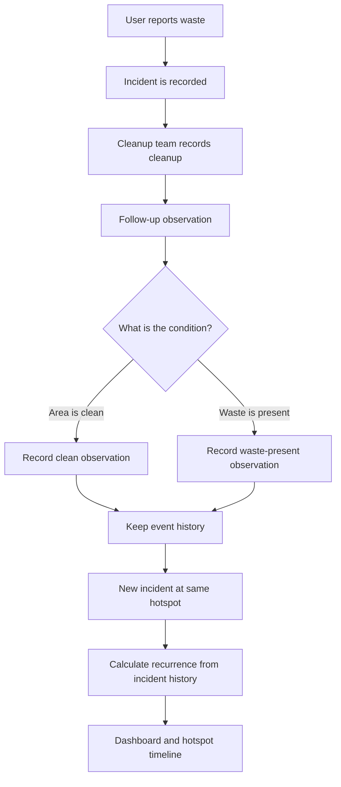
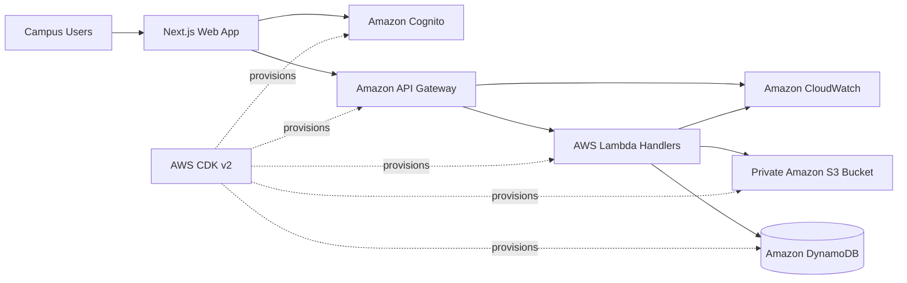

<div align="center">

# CleanLoop 🌱

### The Trash That Came Back.

**Track. Clean. Prevent. Repeat.**

A serverless environmental operations platform that connects waste reports, cleanup records, follow-up observations, and recurring hotspots, helping campus teams understand where waste keeps returning.

[Live Demo](https://main.d3h59s5cvlnbfm.amplifyapp.com/dashboard) · [AWS Builder Center Article](https://builder.aws.com/content/3KX2nWqutIGMAXLX4r6ijPrqkGP/the-trash-that-came-back-building-cleanloop-with-aws-serverless-architecture)

</div>

---

## 🌍 The Problem

Cleaning a location once does not guarantee that it will stay clean. When reports, cleanup work, and later observations are disconnected, teams can struggle to identify places where waste repeatedly appears.

CleanLoop is designed to make that history easier to follow. Instead of treating cleanup as the end of the process, it connects each stage so users can review what happened at a hotspot over time.

## 💡 The Solution

CleanLoop links four operational steps:

1. **Report** a waste incident at a known location.
2. **Record** the cleanup activity.
3. **Follow up** to observe whether the area is clean or waste is still present.
4. **Review recurrence** when another incident is reported at the same hotspot.

The result is a clearer incident history and a dashboard intended to help teams prioritize follow-up and attention. Recurrence signals a repeated pattern; it does not, by itself, prove why waste returned or establish that a cleanup failed.

## 🔄 How It Works



## ✨ Key Features

- **Incident reporting:** capture waste incidents against predefined hotspots.
- **Cleanup tracking:** record cleanup activity separately from the original report.
- **Follow-up observations:** record the condition observed after cleanup.
- **Recurring hotspot history:** review incidents and observations associated with the same location.
- **Dashboard and analytics:** surface operational counts and hotspot patterns from application data.
- **Role-aware workflows:** separate experiences for `STUDENT`, `CLEANUP_TEAM`, and `ADMIN` users.
- **Evidence uploads:** use a private S3 storage flow with presigned URLs, as configured in the architecture.
- **Infrastructure as code:** define AWS infrastructure using AWS CDK v2 and TypeScript.

## 🗺️ Initial Hotspots

| ID | Location |
|---|---|
| `HOTSPOT-001` | Library Gate |
| `HOTSPOT-002` | Main Entrance |
| `HOTSPOT-003` | Cafeteria Area |
| `HOTSPOT-004` | Science Block |
| `HOTSPOT-005` | Parking Area |

## 🧱 Architecture

CleanLoop uses a web frontend backed by AWS serverless services.



### AWS Services

| Service | Purpose in CleanLoop |
|---|---|
| **AWS Amplify Hosting** | Hosts the web application |
| **Amazon Cognito** | Authentication and role groups |
| **Amazon API Gateway** | REST API entry point and Cognito authorization |
| **AWS Lambda** | Serverless handlers for incidents, cleanups, follow-ups, hotspots, analytics, and uploads |
| **Amazon DynamoDB** | Stores application records using a single-table design |
| **Amazon S3** | Private storage for evidence media |
| **Amazon CloudWatch** | Application and API logs |
| **AWS CDK v2** | Infrastructure definitions in TypeScript |

### Technology Stack

- **Frontend:** Next.js 16 App Router, React 19, TypeScript, Tailwind CSS, Lucide icons
- **Backend:** AWS Lambda, Node.js 20.x, TypeScript
- **Authentication:** Amazon Cognito
- **API:** Amazon API Gateway REST API
- **Database:** Amazon DynamoDB
- **Object storage:** Amazon S3
- **Observability:** Amazon CloudWatch
- **Infrastructure as code:** AWS CDK v2, TypeScript

For deeper implementation details, see [`docs/architecture.md`](docs/architecture.md), [`docs/database.md`](docs/database.md), and [`docs/deployment.md`](docs/deployment.md), if present in the repository.

## 🧪 Run Locally

### Prerequisites

- Node.js and npm
- Git
- AWS configuration for any features that call deployed AWS resources

### Frontend

```bash
git clone https://github.com/devesh1705hemu/Clean-Loop.git
cd Clean-Loop/frontend
npm install
npm run dev
```

Open [http://localhost:3000](http://localhost:3000).

### Backend build and tests

```bash
cd backend
npm install
npm run build
npm test
```

### Infrastructure build and synthesis

```bash
cd infra
npm install
npm run build
npx cdk synth
```

Run the frontend, backend, and infrastructure commands from their respective directories. The deployed app may require environment variables and AWS resources configured for your environment. Do not commit credentials, access keys, or secret values.

## 🗂️ Repository Structure

```text
Clean-Loop/
├── docs/
│   ├── architecture.md
│   ├── database.md
│   ├── deployment.md
│   └── future-roadmap.md
├── frontend/
│   ├── src/
│   │   ├── app/
│   │   ├── components/
│   │   ├── context/
│   │   ├── lib/
│   │   └── types/
│   └── .env.example
├── backend/
│   ├── src/
│   │   ├── handlers/
│   │   ├── services/
│   │   ├── scripts/
│   │   └── utils/
│   └── tests/
└── infra/
    ├── bin/
    └── lib/
```

## 🔐 Security Considerations

- Keep evidence media in a private S3 bucket.
- Use short-lived presigned URLs for controlled uploads.
- Protect API routes with the configured Cognito authorizer.
- Apply least-privilege IAM permissions to backend functions.
- Store local configuration in environment files that are excluded from Git.
- Never publish AWS access keys, secret keys, tokens, or other credentials in the repository.

These are architecture goals/configuration details; review the deployed AWS settings and policies to confirm they match the current environment.

## 🧭 Roadmap

Potential next steps for the project include:

- Validate the workflow with real campus users and cleanup teams.
- Improve hotspot history and follow-up reporting based on user feedback.
- Add clearer operational guidance for locations with repeated incidents.
- Expand accessibility and mobile usability testing.
- Document deployment, cost controls, and operational monitoring.

## 📚 Project Article

Read the project story on AWS Builder Center:

**[The Trash That Came Back: Building CleanLoop with AWS Serverless Architecture](https://builder.aws.com/content/3KX2nWqutIGMAXLX4r6ijPrqkGP/the-trash-that-came-back-building-cleanloop-with-aws-serverless-architecture)**

## 👤 Author

Built by **Devesh Arya** for the Environmental Hacks challenge.

---

<div align="center">

**CleanLoop · Track. Clean. Prevent. Repeat.** 🌱

</div>
