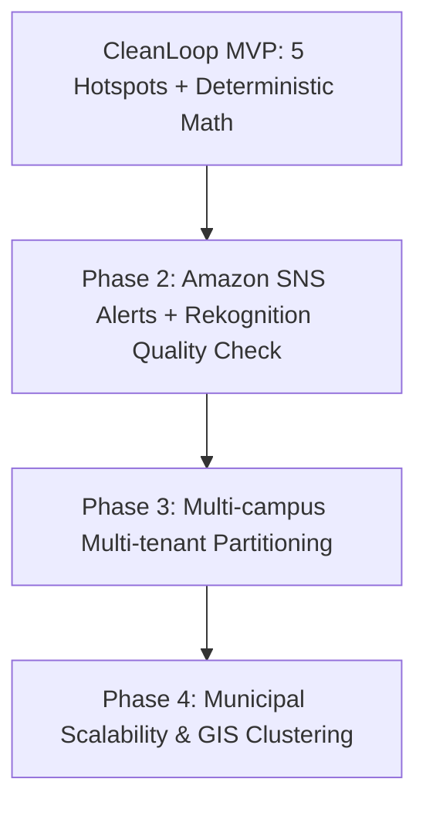

# CleanLoop: Future Roadmap & Post-MVP Architecture

This document records architectural, functional, and operational items intentionally excluded from the initial CleanLoop MVP to preserve focus on the core workflow:
**Report Waste → Cleanup → Follow-up Audit → Recurrence Engine → Admin Dashboard**.

---

## 1. Explicitly Excluded Features (Out of Scope for MVP)

| Excluded Feature | Reason Excluded | Future Consideration / Target Phase |
|---|---|---|
| **AI / Machine Learning Predictions** | MVP relies strictly on deterministic counts to verify recurrence without black-box logic. | Phase 2.0: Predictive waste accumulation models using seasonal campus calendars. |
| **Advanced GIS & Dynamic Polygon Geofencing** | MVP uses 5 predefined hotspots (`HOTSPOT-001` to `005`) with deterministic coordinates. | Phase 2.0: PostGIS / Amazon Location Service integration with dynamic geospatial clustering. |
| **Native Mobile Application (iOS/Android)** | MVP is built on responsive Next.js web application for universal accessibility. | Phase 2.5: React Native or Flutter companion app for field maintenance staff with offline mode. |
| **Push / SMS / Email Notifications** | Unnecessary operational overhead for core proof-of-concept validation. | Phase 2.0: Amazon SNS / Amazon SES for automated notifications on recurrence alerts. |
| **Gamification, Badges & Leaderboards** | Avoids incentivizing trivial or fabricated reports during validation. | Phase 3.0: Eco-points, campus sustainability credits, student leadership badges. |
| **Public Social Feed & Upvoting** | MVP focuses on structured accountability rather than social commentary. | Phase 3.0: Campus community board with verified before/after cleanup stories. |
| **Complex Content Moderation** | Kept minimal with role-based Cognito authorization and student accounts. | Phase 2.5: Automated Amazon Rekognition image verification to filter irrelevant uploads. |
| **City-Wide Geographic Deployment** | Target deployment is restricted to a single defined university campus boundary. | Phase 4.0: Multi-tenant municipal deployment supporting city wards and sanitation districts. |
| **Automated Root-Cause Analysis** | "Recurrence indicates repeated observations. It does not establish the cause of the waste." | Phase 3.5: Correlating pedestrian footfall, event schedules, and bin capacities. |

---

## 2. Architectural Evolution Plan

---

## 3. Guiding Principle
CleanLoop prioritizes **deterministic data integrity** and **closed-loop accountability** over speculative automation.
